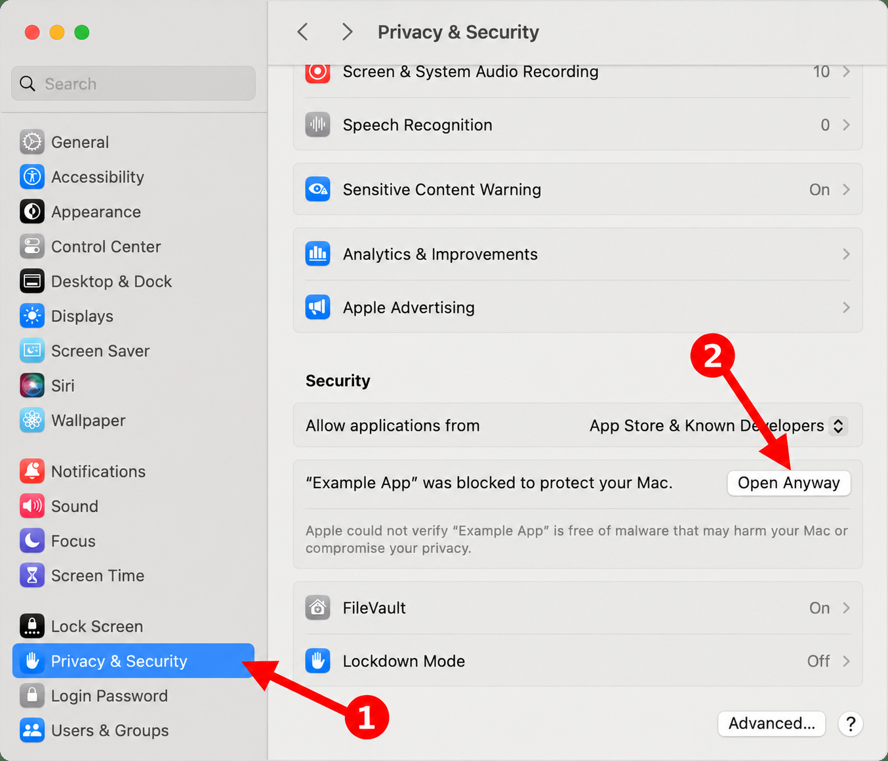

# Lessavio Desktop

Formerly **Tutorly**. The source version is now **Lessavio 0.5.0**; your existing local workspace remains compatible.

**Your students, lessons, and payments — in one offline desktop app.**

## Download and install

[](https://github.com/Lessavio/Lessavio-desktop/releases/download/desktop-v0.5.0/Lessavio-Windows-Setup.exe)
[](https://github.com/Lessavio/Lessavio-desktop/releases/download/desktop-v0.5.0/Lessavio-macOS.dmg)

**Windows:** download and run the installer. **Mac:** open the DMG and drag the app into Applications. The macOS release download is intended for both Apple Silicon and Intel Macs.

> **Download status:** **Lessavio 0.5.0** is published with installers for macOS (Apple Silicon and Intel) and Windows x64. These are unsigned preview builds. See the [release notes](https://github.com/Lessavio/Lessavio-desktop/releases/tag/desktop-v0.5.0).

[Detailed macOS installation](#macos) · [Detailed Windows installation](#windows)

---

**A private, offline desktop workspace for independent tutors.**

Lessavio helps you organize students, schedule lessons, and track payments on your own computer. Each tutor sets up a local profile and works with their own data. A local-only mode needs no account or hosted database. Source version 0.5.0 also adds optional Firebase email/password accounts; teaching records remain local and cloud synchronization is not enabled.

Built with **Tauri 2, React, TypeScript, Rust, and SQLite** for macOS and Windows.

> **Source version: Lessavio 0.5.0 — early preview.** Includes Russian, Ukrainian, and English, improved selectors, and recurring lessons with separate times for each weekday. Universal macOS and Windows x64 installers are provided through GitHub Releases. Full native installation and interface testing on both platforms remains pending. Current installers are not signed with a publisher certificate.

## Optional accounts (source version 0.5.0)

Choose **Sign in or create an account**, or **Continue without an account**. Email/password accounts support verification email, password reset, and saved sessions. Account actions use Firebase Authentication and need internet access; previously restored sessions can continue using local records offline.

Each account opens a separate local workspace. Sign-out preserves its data. Existing data from 0.4.0 stays in the workspace available without an account; sign in and use **Settings → Lessavio account → Data from before registration → Copy local data** to copy it into an empty account workspace. The original remains available and the copies do not synchronize.

Accounts are included in the published 0.5.0 installers. See [account setup and future sync architecture](docs/accounts-and-sync.md). Export a backup before upgrading; after editing in 0.5.0, do not downgrade to 0.4.0 because older binaries read the legacy migration snapshot.

## Optional usage analytics (source version 0.5.0)

In **Settings → Usage analytics**, choose **Help improve Lessavio** to enable Google Analytics for Firebase. It is off by default. Collection includes app/screen/feature usage and technical metadata, not student records, email addresses, Firebase auth UIDs, lesson dates, or payment amounts. Google processes browser/installation identifiers and network metadata. Your choice stays on this device and can be turned off at any time. Teaching data remains local. See [Analytics details and setup](docs/analytics.md).

## Contents

- [What you can do](#what-you-can-do)
- [Install the application](#install-the-application)
- [Your first session](#your-first-session)
- [Payments and balances](#payments-and-balances)
- [Data, privacy, and backups](#data-privacy-and-backups)
- [Update or uninstall](#update-or-uninstall)
- [Run from source](#run-from-source)
- [Troubleshooting](#troubleshooting)
- [Current limitations](#current-limitations)
- [Developer documentation](desktop/README.md)

## What you can do

| Area | Features |
| --- | --- |
| Today | See today's lessons, the next scheduled lesson, active student count, and outstanding balances. |
| Students | Save names, subjects, contact numbers, lesson prices, and notes. Search students and archive inactive profiles. |
| Calendar | View a monthly schedule, add and edit lessons, and detect overlapping appointments. |
| Lessons | Set the date, duration, price, and notes. Mark a lesson as scheduled, completed, or cancelled. |
| Payments | Record payments, view a student's payment history, and remove an incorrect entry after confirmation. |
| Settings | Set your name, currency, and time zone. Export and restore a backup. |

Lessavio runs locally after installation. You do not need an internet connection for everyday work, and you do not need to install a database server.

## Install the application

### Download an installer

Open the repository's **[Releases page](https://github.com/Lessavio/Lessavio-desktop/releases)** and expand **Assets** for the version you want.

| Your computer | File to download |
| --- | --- |
| Mac with Apple Silicon (M1, M2, M3, or newer) | A `.dmg` marked `aarch64`, or a universal macOS `.dmg`. |
| Mac with an Intel processor | A universal macOS `.dmg`, or an Intel-specific build if provided. An `aarch64` installer is not for Intel Macs. |
| Windows PC with an Intel or AMD 64-bit processor | The Windows installer ending in `setup.exe`. |

On a Mac, open **Apple menu → About This Mac** to check the processor.

**Availability:** [version 0.5.0](https://github.com/Lessavio/Lessavio-desktop/releases/tag/desktop-v0.5.0) includes published macOS and Windows installers. Future workflow runs create a draft release that the maintainer must publish. GitHub's “Source code” ZIP and TAR.GZ downloads are source files, not installers.

You do **not** need Git, Node.js, Rust, or PostgreSQL to use a ready-made installer.

### macOS

1. Download the `.dmg` matching your processor.
2. Double-click it to mount the disk image.
3. Drag the application into **Applications**. The application is named **Lessavio.app**.
4. Eject the disk image.
5. Open **Lessavio** from Applications.
6. Complete the local profile setup described below.

Current preview builds are not signed with an Apple Developer ID or notarized. macOS may display an unidentified developer warning or block opening the application. Verify that you obtained the file from this repository or its maintainer. If the system blocks it, use Apple's documented approval flow only if you trust the build; no system-wide security changes are required by Lessavio. Maintainers should configure signing and notarization for public distribution. See [Tauri's macOS signing documentation](https://v2.tauri.app/distribute/sign/macos/).




**1 — Privacy & Security. 2 — Open Anyway.** Scroll down to the Security section first. The button appears after macOS blocks an attempted launch.

*Illustrative screenshot from [Apple Support](https://support.apple.com/en-us/102445), annotated with AI-assisted arrows. “Example App” represents Lessavio; macOS layout and wording may vary.*

### Windows

1. Download the Windows `setup.exe` installer.
2. Open it and follow the installation wizard.
3. Launch the app from the Start menu or its shortcut (**Lessavio**).
4. Complete the local profile setup described below.

The Windows app uses **Microsoft Edge WebView2 Runtime** to display its interface. If it is missing, the installer may need an internet connection to download it. Once installed, Lessavio's normal features work offline. See [Tauri's Windows installer documentation](https://v2.tauri.app/distribute/windows-installer/).

Windows may show an unknown publisher or SmartScreen warning for an unsigned preview installer. Verify the source before proceeding; contact the maintainer if you are unsure. The current workflow does not produce a Windows ARM-specific build.

## Your first session

1. **Create your local profile.** Enter your name, select UAH, EUR, or USD, and check the time zone.
2. **Add a student.** Open **Ученики** (Students), then **Добавить ученика** (Add student). Enter a name, subject, and default lesson price. A phone number and notes are optional.
3. **Schedule a lesson.** Select **Добавить занятие** (Add lesson), choose the student, and enter the date, time, duration, and price.
4. **Complete a lesson.** Mark it **Проведено** (Completed) after teaching it. Its price will then count toward the student's balance.
5. **Record a payment.** Open the student card and select **Записать оплату** (Record payment).
6. **Save a backup.** Open **Настройки** (Settings) and export a copy to a safe location.

There is no email address, password, or online account. Reopening Lessavio loads the saved workspace for the current operating-system account.

### Recurring lessons (0.2.0)

Open **Recurring lessons** from Today, Calendar, or a student card. Select the weekdays and give each its own time, such as Monday 16:00, Friday 18:00, and Saturday 12:30. Choose the date range, lesson duration, and price. Repeat weekly or every two weeks.

The preview shows the exact dates and any conflicts. Conflicting schedules are not saved. Lessons follow the profile's time zone and keep their local times across daylight saving changes. All occurrences are created together through the end date; the app does not automatically extend the series beyond that date. You can edit or cancel an individual lesson, or confirm cancellation of future scheduled lessons in its series.

Recurring lessons are included in version 0.2.0. Install the current release to use them.

### Interface language (0.2.0)

New installations start in **English**, regardless of the system language. At first launch or in **Settings → Interface language**, choose **Русский**, **Українська**, or **English**. On an existing profile, changing the language applies and saves it immediately. Your preference is retained after reopening the desktop app and is included in backups. Existing profiles without a language preference continue in Russian.

Language selection is included in the version 0.2.0 installers.

### Currency and time zones

- Amounts are stored in integer minor units, such as cents or kopecks.
- Changing the currency changes the currency label; it **does not convert existing amounts**.
- Lesson timestamps are stored in UTC and displayed using the profile's time zone.
- The lesson date/time input uses the **computer's time zone**, which is shown in the form. Check this label if your profile uses a different zone.

## Payments and balances

A student's balance is calculated as:

```text
Balance = total recorded payments − total price of completed lessons
```

- **Negative balance:** the student owes money.
- **Zero balance:** completed lessons are fully covered.
- **Positive balance:** the student has prepaid credit.

For example, two completed lessons at 500 UAH each and a payment of 700 UAH produce a balance of **−300 UAH**.

Scheduled and cancelled lessons do not deduct money. Marking a completed lesson as cancelled removes its charge from the calculation. Payments are recorded against a student's overall balance; they are not allocated to individual lessons.

## Data, privacy, and backups

### Where data lives

Lessavio stores a local SQLite database named `tutorly.sqlite` in the operating system's application data directory, separately from the installed program.

- **macOS:** `~/Library/Application Support/com.tutorly.desktop/`
- **Windows:** the system application data directory for `com.tutorly.desktop`, normally `%APPDATA%\com.tutorly.desktop\`.

Lessavio does not upload your student records, schedule, or payments to GitHub or a cloud service. The desktop app does not require the older web application's backend or environment variables. The local database and exported backups are not encrypted by Lessavio; protect access to your computer and backup files.

Each OS account has its own application data directory. Separate computers do not share or automatically synchronize data. There is one tutor profile per local workspace in this version; there is no in-app profile switcher.

### Export a backup

1. Open **Настройки** (Settings).
2. Select **Сохранить резервную копию** (Save backup).
3. Choose a destination in the system file dialog.
4. Save the `.json` file on another drive or in another location you trust.

A backup contains the profile, students, lessons, and payment history. It includes personal information in plain text. Keep regular copies, especially before updates, restoration, or moving to another computer. A copy kept only on the same disk will not protect against disk failure.

### Restore a backup or move to another computer

1. Export a backup on the original computer.
2. Install Lessavio on the destination computer. If prompted, create a temporary local profile to reach Settings.
3. Open **Настройки** (Settings) and select **Восстановить из копии** (Restore from backup).
4. Select the exported Lessavio `.json` file.
5. Review the confirmation and approve restoration.

**Restoration replaces the current workspace; it does not merge records.** Export the current workspace first if you want to keep it. Lessavio validates the backup format before saving it. The current file-size limit is 20 MB.

Lessavio also keeps up to 14 internal daily snapshots in the same SQLite database. They do not have a recovery screen yet and are not a substitute for an external backup.

Avoid moving or copying the live SQLite files while Lessavio is open. Use the app's export feature for normal backups and transfers.

## Scheduling, finances, and reminders (0.4.0)

- **Edit a series:** open an occurrence and choose **Edit series**. Apply changes to future lessons or all scheduled lessons. Adjust weekdays, times, duration, price, and end date with a preview and conflict checks. Completed and cancelled records and payments are preserved; protected dates are not recreated.
- **Drag to reschedule:** drag a scheduled lesson onto another day in Month view or a time slot in Week view (30-minute snapping). Review the date and exact time before confirming. Moving one occurrence does not change the rest of its series. Completed and cancelled lessons cannot be dragged.
- **Financial overview:** choose a month to see payments received, completed lesson value, planned value, and student balances. Month-end debt and credit include earlier history and remain separate across students. Dates follow the profile time zone.
- **Local reminders:** in Settings, select 5, 10, 15, 30, or 60 minutes and allow system notifications. A test button checks delivery. Reminders run in the native process while the app is open, including when minimized; they stop after quitting. The computer must be awake, and OS notification settings apply. After sleep, reminders are sent only for lessons that have not started. Sent reminders are tracked locally in SQLite to prevent repeated delivery after restart.

These features are included in the published Lessavio 0.5.0 installers linked at the top of the main README.

## Rename compatibility (0.3.0)

Lessavio is the new name of Tutorly. Version 0.3.0 intentionally keeps the existing `com.tutorly.desktop` identifier and `tutorly.sqlite` database filename so it can open the same local workspace without a data transfer. Existing JSON backups can still be restored, regardless of the filename.

Export a backup and quit Tutorly before launching Lessavio. On macOS, the new bundle has a different filename (`Lessavio.app`), so the old `Tutorly.app` may remain in Applications. After checking your data in Lessavio, you can remove the old app bundle; keep the shared application data folder. Do not run both names simultaneously. The GitHub repository address remains unchanged.

## Update or uninstall

### Update

1. Export a backup.
2. Close Lessavio.
3. Download the newer installer for your platform from Releases.
4. Install it in the same way as the original version, replacing the existing app when prompted.
5. Open Lessavio and check your workspace.

Automatic updates are not implemented in version 0.5.0. Data is stored separately from the application bundle, but keeping an external backup before an update is recommended.

### Uninstall

- **macOS:** quit Lessavio and move the application from Applications to the Trash.
- **Windows:** uninstall Lessavio through the operating system's installed-apps settings.

Application files and workspace data are separate. Do not assume uninstalling erases all personal data. To remove the workspace permanently, first export anything you need, close the app, and then remove its application data folder. Deleting that folder removes the local database and internal snapshots. Exported backup files must be removed separately if you no longer need them.

## Run from source

This section is for developers and users who want to build the app themselves. It is not required when installing a ready-made release.

### Prerequisites

Install:

- **Git** to clone the repository.
- **Node.js 22.18 or newer** with npm; the test command uses Node's TypeScript stripping support.
- **Rust stable** with Cargo, using the official [Rust installation instructions](https://www.rust-lang.org/tools/install).
- The native build tools for your operating system.

**macOS:** install Xcode Command Line Tools:

```sh
xcode-select --install
```

**Windows:** install Microsoft C++ Build Tools with the **Desktop development with C++** workload and a Windows SDK, plus Microsoft Edge WebView2 Runtime. Use the MSVC Rust toolchain.

Follow the official [Tauri prerequisites](https://v2.tauri.app/start/prerequisites/) for the complete platform setup.

### Clone, install, and start

The following commands work from Terminal on macOS or PowerShell on Windows:

```sh
git clone https://github.com/Lessavio/Lessavio-desktop.git Lessavio
cd Lessavio
npm ci --prefix desktop
npm run desktop:dev
```

The first launch downloads and compiles Rust dependencies, so it requires an internet connection and can take several minutes. Subsequent launches reuse the build cache.

Use **`npm run desktop:dev`** for the native application. The root `npm run dev` command belongs to the older web version.

### Browser-only preview

```sh
npm run dev --prefix desktop
```

Open `http://127.0.0.1:1420/`.

This is an interface preview with session-only, in-memory data. **Reloading or closing the page loses preview data.** SQLite storage and native backup dialogs require the desktop application.

### Build an installer

Build on the matching operating system.

**macOS:**

```sh
cd desktop
npm run bundle -- --bundles app,dmg
```

This builds for your Mac's current architecture. To build a universal installer for Apple Silicon and Intel:

```sh
rustup target add aarch64-apple-darwin x86_64-apple-darwin
npm run bundle -- --target universal-apple-darwin --bundles app,dmg
```

**Windows:**

```powershell
cd desktop
npm run bundle -- --bundles nsis
```

Output is written to `desktop/src-tauri/target/release/bundle/`, or to the target-specific `target/<target>/release/bundle/` directory when `--target` is supplied.

For tests, architecture details, and release publishing, see the [developer guide](desktop/README.md).

## Troubleshooting

| Problem | What to check |
| --- | --- |
| No installer is listed on GitHub | The release may still be a draft or may not have been built. Use source installation or ask the maintainer. |
| A Mac installer does not run on an Intel Mac | Choose a universal or Intel build; an `aarch64` build is for Apple Silicon. |
| The OS blocks an unsigned installer | Verify its origin and consult the maintainer. Public releases should be signed; do not disable system security globally. |
| Windows shows a blank window or cannot initialize the interface | Check that Microsoft Edge WebView2 Runtime is installed. |
| Data disappears after a browser refresh | You are using the browser preview. Launch the native app with `npm run desktop:dev` or install a release. |
| Lessavio reports a data loading error | Do not delete the database. Close other copies of the app and check permissions or available disk space. Retry, and keep a copy of existing data before attempting recovery. |
| A lesson cannot be saved due to a conflict | Check other non-cancelled lessons. Overlapping times are blocked, including lessons for different students. |
| A balance is unexpected | Check completed lesson prices and recorded payments. Scheduled lessons do not deduct funds. |
| `cargo` or `rustc` is not found | Install Rust and reopen the terminal so its PATH changes are loaded. |
| Development port 1420 is already in use | Stop the earlier Lessavio development server and retry. |

## Current limitations

Version 0.5.0 does not include automatic synchronization, automatic updates, payment editing, or an internal snapshot recovery screen. Recurring lessons are generated through the end date you select; they do not extend automatically. To correct a payment, remove the incorrect entry and record a new one.

This is a new desktop implementation. The older web application remains in `client/` and `src/`; it is not used by Lessavio Desktop, and its data is not imported.
